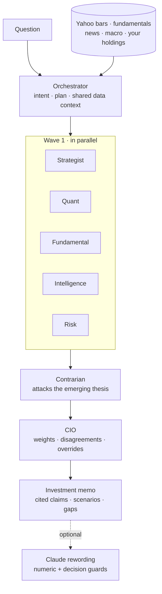
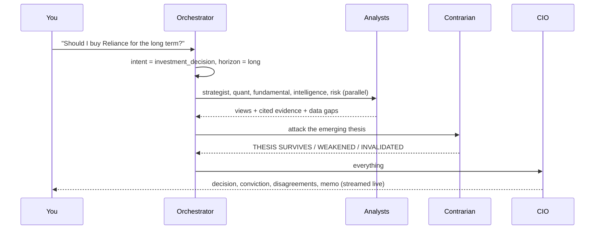

<div align="center">

# EquityLens

**An investment committee for Indian equities, built from evidence rather than adjectives.**

Ask a question. One orchestrator convenes the specialists it needs (strategist, quant, fundamental analyst,
intelligence desk, risk manager and contrarian) and a CIO weighs their cited evidence into a decision.
Every number links to its source, every gap is stated, and nothing is guessed.

[Architecture](docs/ARCHITECTURE.md) · [The seven agents](docs/AGENTS.md) · [Orchestrator](docs/ORCHESTRATOR.md) ·
[Evidence engine](docs/EVIDENCE_ENGINE.md) · [Model evaluation](docs/MODEL_EVALUATION.md) · [Limitations](docs/AI_LIMITATIONS.md)

   

</div>

> **Not investment advice.** EquityLens is a research and educational tool. Its decisions summarise evidence under
> published rules; those rules have **not** been validated against future returns, and no model in this project has
> shown skill at predicting price direction. Market data comes from Yahoo Finance and may be delayed or wrong.

---

## The idea

Most "AI stock analysis" is a language model writing confident paragraphs around numbers it made up. EquityLens
inverts that:

- **Data first.** Prices, fundamentals, headlines and macro quotes come from providers, with their timestamps.
- **Analysis is code.** Each specialist is a deterministic rule set you can read, test and argue with.
- **Disagreement is a feature.** A risk manager that is never bullish and a contrarian whose only job is to break
  the thesis sit on the same committee as the analysts.
- **The LLM is optional and last.** Claude may reword the final thesis, but only if every number it writes appears
  in the evidence and it states the committee's decision exactly. Otherwise its text is discarded.

## Architecture



One orchestrator. Seven specialists, each with a published contract. The CIO is a specialist that decides, not a
second orchestrator. Questions route to the **minimum** set of agents ("Why did TCS fall?" needs three analysts, not
seven), and questions the data cannot answer are refused with `INSUFFICIENT DATA` instead of being analysed from
guesses.

## The committee

| | Agent | Looks at | Never does |
|---|---|---|---|
| 01 | **Strategist** | Market regime (NIFTY vs 200-day average, India VIX) and what historically followed it; India VIX, USD/INR, US 10Y, Brent, S&P 500; the sector's week | Invent policy rates, CPI or GDP (no feed: reported unavailable); go beyond a "lean" view, because regimes describe risk, not returns |
| 02 | **Quant** | Six published rules (trend, 6- and 12-1-month momentum, MACD, 52-week position, RSI), beta and correlation, the validated volatility model | Report a direction probability: none passed validation. Its own rule score was tested point-in-time and showed no edge, which every result cites and the CIO weighs at half |
| 03 | **Fundamental** | Growth, profitability, balance sheet, valuation, PEG, scored against fixed thresholds | Estimate ROCE, FCF yield, moat or management quality (no data: `DATA_UNAVAILABLE`); score debt/equity for banks |
| 04 | **Intelligence** | Dated, sourced headlines with publisher reliability and catalyst type | Call a headline the cause of a move, call anything "breaking", or follow instructions planted in a headline |
| 05 | **Risk** | Volatility, drawdown, 95% VaR and CVaR, Sharpe/Sortino, liquidity, real replays of the 2020 crash and 2022 sell-off, position ceilings | Be bullish. It is the committee's brake, and it caps the decision |
| 06 | **Contrarian** | The other agents' evidence, looking for stretched valuation, over-extension, ignored risk, disagreement, missing data, survivorship | Add conviction. It returns THESIS SURVIVES, WEAKENED or INVALIDATED |
| 07 | **CIO** | All of the above, weighted by role, horizon and evidence quality | Average blindly, force a decision on thin evidence, or call conviction a probability |

Every threshold, weight and override is in [docs/AGENTS.md](docs/AGENTS.md). On the site, the public **/team** page
introduces each member, how it works step by step, what it never does and the team's measured track record.

## How a decision is made



The CIO weights each analyst by **role × horizon × evidence quality** (confidence × source reliability × freshness),
maps the score to one of `STRONG BUY · BUY · ACCUMULATE · HOLD · WATCH · REDUCE · SELL · AVOID · INSUFFICIENT DATA`,
then applies overrides: HIGH risk caps at ACCUMULATE, EXTREME at WATCH, a weakened or invalidated thesis downgrades,
and STRONG BUY needs unanimity, two outright bulls, a surviving thesis and moderate risk.

## What else is in the box

| Area | What is implemented |
|---|---|
| Risk model | `volatility-ridge` forecasts the size of the next 5 days' moves with an 80% range; walk-forward validated (lower error than repeating recent volatility in 14/14 test periods) and tested on 25 former index members it never saw |
| Model evidence | `/models` publishes every model trained, including the rejected direction models |
| Research | "Why is X moving?": today's move split into market and stock-specific parts, with cited headlines |
| Backtesting | Rules on daily history with next-open fills, fees and slippage; walk-forward validation |
| Portfolio | Holdings with import (CSV, XLSX, PDF, screenshot OCR); concentration, beta, correlation, drawdown, VaR, risk contribution, liquidity, stress replays, style exposures, model-based forward volatility, performance vs NIFTY 50 |
| Live | Delayed quotes streamed over SSE from one shared poll, with a move-vs-forecast signal |
| Alerts | Telegram and Web Push alerts and a daily briefing, with per-user de-duplication |
| Accounts | Email + password with verification, Google sign-in, session revocation, role-based admin |
| Accessibility | WCAG 2.1 AA (axe) on public pages in both themes; command palette (Ctrl/Cmd+K); reduced-motion support |

## Tech stack

| Layer | Choice |
|---|---|
| App | Next.js 16 (App Router), React 19, TypeScript (strict) |
| Data | PostgreSQL via Prisma 5; Upstash Redis REST for shared cache and rate limits (in-memory fallback) |
| Market data | Yahoo Finance (`yahoo-finance2`), RSS and optional Finnhub/NewsAPI |
| ML | Python + scikit-learn offline (purged walk-forward, calibration, pre-registered gate); JSON artifacts served by TypeScript inference with 1e-6 parity |
| LLM | Claude via the Anthropic SDK, optional, behind numeric and decision guards |
| Auth | NextAuth v5 (JWT sessions revalidated against the database) |
| Observability | Structured JSON logs, in-process metrics, Sentry when a DSN is set |
| Testing | Vitest, Playwright (+ axe), Python unittest; GitHub Actions |

## Project structure

```
app/                  pages and API routes (app/api/agents/committee is the committee endpoint)
components/research/  committee workspace, agent activity, memo, evidence views
lib/agents/           orchestrator, intent parser, router, data context, the seven agents, memo, evidence engine
lib/ai/               evidence contract, numeric guard, LLM explainers
lib/ml/               features, volatility model inference, regime, registry
lib/portfolio/        portfolio risk engine (VaR, CVaR, stress, factors)
lib/backtest/         backtest engine and walk-forward validation
lib/services/         market data, fundamentals, news, macro (shared-cached)
ml/                   offline dataset, training and evaluation (Python)
tests/                unit, route and render tests (tests/agents covers the committee)
e2e/                  Playwright: public, signed-in and accessibility tiers
docs/                 architecture, agents, orchestrator, evidence, ML, security, testing
```

## Honesty, enforced in code

| Rule | Enforcement |
|---|---|
| No invented values | Missing inputs are `null` or `DATA_UNAVAILABLE`, never defaults; regression tests guard known past fabrications |
| Every claim is traceable | Claims cite evidence ids; results with dangling citations fail validation; the memo is integrity-checked |
| The LLM cannot add numbers or change decisions | `checkExplanation` and `checkDecisionConsistency` reject the rewrite |
| Retrieved text is data | Headlines are sanitized; instruction-like text is quarantined; prompts wrap data as untrusted |
| No fake progress | The agent activity view renders real orchestrator events streamed as they happen |
| No unvalidated probabilities | Direction probability is always unavailable; conviction and confidence are labelled as what they are |

## Security

Sessions are required for every non-public API and enforced twice (middleware and route). Cron and webhook secrets
fail closed and compare in constant time. Inputs are validated with Zod; expensive endpoints are rate-limited per
user (the committee: 12 runs/hour). Logs carry request ids, never queries, holdings or secrets. Details:
[docs/SECURITY.md](docs/SECURITY.md).

## Testing

```bash
npm run lint && npm run typecheck && npm test   # unit, route and render tests (counts in docs/TESTING.md)
npm run build && npm run test:e2e               # Playwright; signed-in tier needs E2E_DATABASE_URL
python -m unittest discover -s ml/tests -t .     # ML pipeline: leakage, splits, metrics, deployment gate
```

CI runs lint, typecheck, unit tests, build, a bundle guard, the Python ML tests, Playwright (public, signed-in and
accessibility), a Docker image probe, a dependency audit and database migration checks. See
[docs/TESTING.md](docs/TESTING.md).

## Local development

Requirements: Node 24 and PostgreSQL 14+.

```bash
npm ci
cp .env.example .env.local         # fill in DATABASE_URL and NEXTAUTH_SECRET at minimum
npx prisma migrate deploy
npm run dev                        # http://localhost:3000, then open /research
```

Without `RESEND_API_KEY` / `EMAIL_FROM`, verification and reset emails are printed to the server console in
development and refused in production. Docker: `docker compose up` runs Postgres, migrations and the app.

### Environment variables

| Variable | Needed for |
|---|---|
| `DATABASE_URL`, `NEXTAUTH_SECRET`, `NEXTAUTH_URL` | Required |
| `RESEND_API_KEY`, `EMAIL_FROM` | Verification and password-reset email (required in production) |
| `UPSTASH_REDIS_REST_URL`, `UPSTASH_REDIS_REST_TOKEN` | Shared cache and rate limits across instances (recommended) |
| `ANTHROPIC_API_KEY`, `CLAUDE_MODEL` | Optional guarded Claude wording |
| `CRON_SECRET`, `TELEGRAM_BOT_TOKEN`, `TELEGRAM_WEBHOOK_SECRET`, VAPID keys | Alerts |
| `GOOGLE_CLIENT_ID`, `GOOGLE_CLIENT_SECRET` | Google sign-in |
| `FINNHUB_API_KEY`, `NEWSAPI_KEY` | Extra news sources |
| `SENTRY_DSN`, `HEALTH_SECRET` | Error tracking, detailed health checks |

The full list with comments is in `.env.example`.

## Roadmap

Not built yet, and not claimed anywhere in the product:

- **Validate the committee**: the quant agent's rule score has been tested point-in-time and showed no edge
  (20-day rank IC -0.018), so it counts half in the CIO's weighting. The fundamental and news agents cannot be tested
  until point-in-time data exists; until then no decision label has a measured edge.
- Point-in-time fundamentals and an events calendar, so fundamental and catalyst signals can be tested historically.
- Policy-rate, CPI and flow data feeds for the strategist.
- An enforced (nonce-based) Content Security Policy and an audit log.
- Splitting the remaining large legacy pages (landing, scanner, alerts, history, analyze).

## Contributing

Open an issue describing the problem first. Pull requests need passing lint, typecheck, unit tests and build; new
behaviour needs tests, and anything user-facing must not state a number the code did not compute. The engineering
conventions are in [docs/ARCHITECTURE.md](docs/ARCHITECTURE.md) and [docs/TESTING.md](docs/TESTING.md).

## License

No license has been declared yet, so default copyright applies. Contact the repository owner before reusing the code.

## Disclaimer

EquityLens is a research and educational platform. It does not provide personalised financial advice, is not a
broker and places no orders. Decisions and conviction scores summarise evidence under published rules and are not
predictions. Past performance does not guarantee future results. Data may be delayed or inaccurate.
